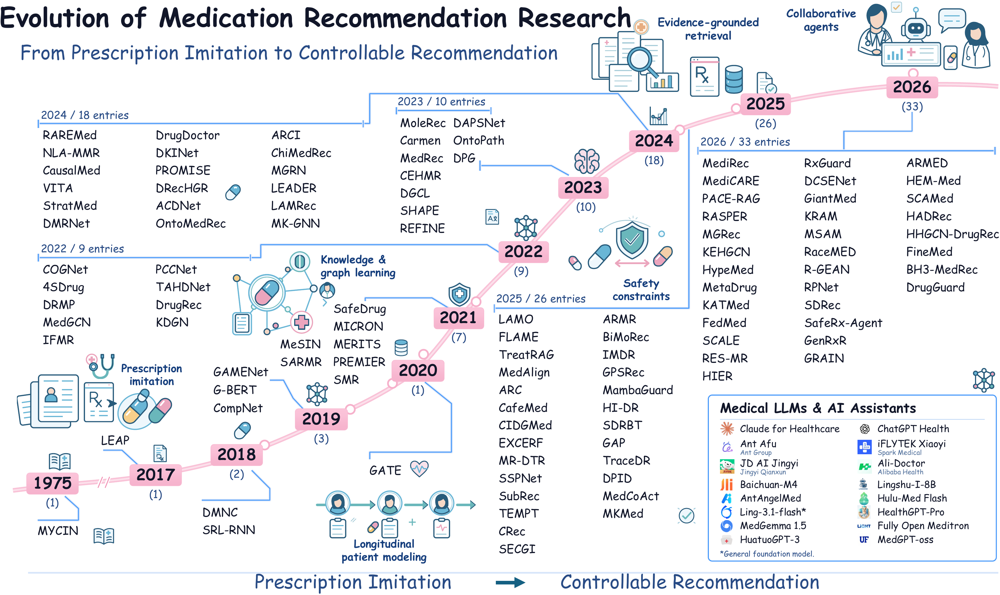
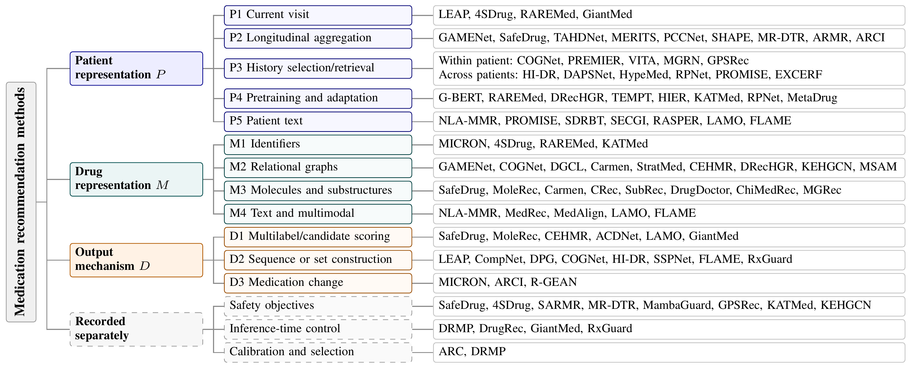
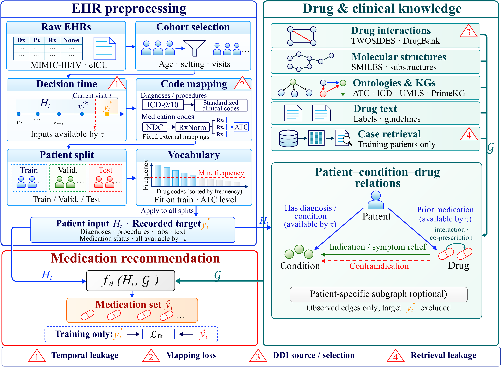
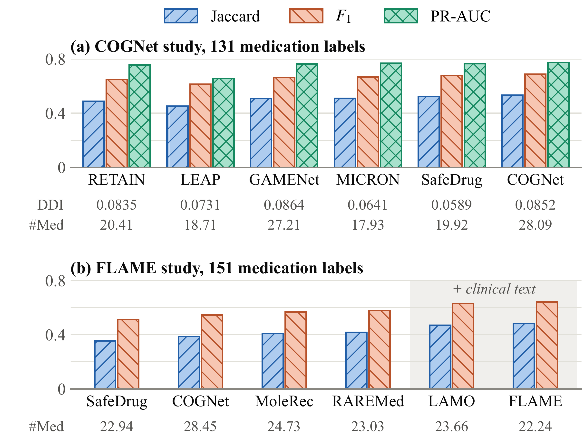

<div align="center">

# 💊 Medication Recommender Systems

**[From Prescription Imitation to Controllable Medication Recommendation:<br>A Survey and Taxonomy](docs/survey/main.pdf)**

Linyu Li<sup>1</sup> · Zhi Jin<sup>1,✉</sup> · Yuanpeng He<sup>1</sup> · Haoran Duan<sup>2</sup> · Dongming Jin<sup>1</sup><br>Jiandong Li<sup>1</sup> · Jia Li<sup>2</sup> · Jin Zhang<sup>3</sup> · Gadeng Luosang<sup>4</sup> · Tashi Nyima<sup>4</sup> · Jiannong Cao<sup>5</sup>

<sup>1</sup>Peking University · <sup>2</sup>Wuhan University · <sup>3</sup>University of Electronic Science and Technology of China<br><sup>4</sup>Tibet University · <sup>5</sup>The Hong Kong Polytechnic University · <sup>✉</sup>Corresponding author

[](#paper-catalog)
[](#code)
[](#scope)

**[Paper](docs/survey/main.pdf) · [Paper list](#paper-catalog) · [Code](#code) · [Datasets](#datasets) · [BibTeX](#citation)**

</div>

**Papers, code, datasets, and benchmarks** accompanying our survey on medication recommendation.

## News

- **2026-11-11** · Updated the survey PDF and the paper list (111 methods and systems, literature through 24 October 2026).

<a id="contents"></a>
## Contents

- **Papers:** [By year](#paper-catalog) · [By topic](#reading-paths) · [Code](#code) · [LLM methods](#llm-roles) · [Specialty tasks](#adjacent)
- **Resources:** [Datasets](#datasets) · [Drug knowledge](#knowledge) · [Benchmarks](#benchmarks) · [Evaluation](#evaluation) · [Files](#repository-files)
- **Survey:** [Taxonomy](#taxonomy) · [Task definition](#task) · [Results](#reported-results) · [Open challenges](#future) · [Related surveys](#related-surveys) · [Citation](#citation)

<a id="scope"></a>
## About the survey

Our survey covers **111 methods and systems** for medication recommendation, including **77 from 2024–2026**. It organizes methods by patient representation, drug representation, and output mechanism, and examines how safety constraints and confidence estimates support controllable recommendations. Of the 111 entries, **50** add an interaction or contraindication term during training, whereas only **9** act on the output at inference and **2** estimate confidence for selective output.

**Literature through:** 24 October 2026 · **Manuscript version:** 11 November 2026

<a id="evolution"></a>
[](assets/readme/evolution.png)

*Survey Figure 1 · Click to enlarge. The medical-model inset is excluded from the 111-entry count.*

<a id="taxonomy"></a>
## Taxonomy at a glance

The survey uses three sets of labels. A method can have several labels within each set; safety and confidence components are listed separately.

| Patient representation | Drug representation | Output mechanism |
|---|---|---|
| **P1** Current visit<br>**P2** Longitudinal aggregation<br>**P3** History selection / retrieval<br>**P4** Pretraining / adaptation<br>**P5** Patient text | **M1** Identifiers<br>**M2** Relational graphs<br>**M3** Molecules / substructures<br>**M4** Text / multimodal | **D1** Multilabel / candidate scoring<br>**D2** Sequence / set construction<br>**D3** Medication change |

[Full taxonomy and examples](#taxonomy-details) · [Scope and research periods](#scope-details)

<a id="reading-paths"></a>
## Where to start

Start with [LEAP](#model-leap) → [GAMENet](#model-gamenet) → [SafeDrug](#model-safedrug) → [COGNet](#model-cognet) → [MoleRec](#model-molerec) for structured models, then [LAMO](#model-lamo) / [FLAME](#model-flame) for LLMs. For confidence and constraints, compare [ARC](#model-arc) and [RxGuard](#model-rxguard).


<details>
<summary><strong>Reading by topic</strong></summary>

| Topic | Start here | Further reading |
|---|---|---|
| Set construction | [LEAP](#model-leap), [COGNet](#model-cognet) | [CompNet](#model-compnet), [DPG](#model-dpg), [SSPNet](#model-sspnet) |
| Patient history | [GAMENet](#model-gamenet), [VITA](#model-vita) | [DAPSNet](#model-dapsnet), [LAMRec](#model-lamrec), [HypeMed](#model-hypemed) |
| Molecular representations | [SafeDrug](#model-safedrug), [MoleRec](#model-molerec) | [CRec](#model-crec), [SubRec](#model-subrec), [MGRec](#model-mgrec) |
| Knowledge graphs and ontologies | [G-BERT](#model-g-bert), [DGCL](#model-dgcl) | [SMR](#model-smr), [OntoMedRec](#model-ontomedrec), [KEHGCN](#model-kehgcn) |
| Rare conditions and short histories | [RAREMed](#model-raremed), [SHAPE](#model-shape) | [DrugDoctor](#model-drugdoctor), [RPNet](#model-rpnet), [MetaDrug](#model-metadrug) |
| Missing data and noisy labels | [MedGCN](#model-medgcn), [IMDR](#model-imdr) | [KDGN](#model-kdgn), [KRAM](#model-kram), [SCALE](#model-scale) |
| Medication changes | [MICRON](#model-micron), [ARCI](#model-arci) | [R-GEAN](#model-r-gean) |
| LLMs | [LAMO](#model-lamo), [FLAME](#model-flame) | [GiantMed](#model-giantmed), [RASPER](#model-rasper), [DCSENet](#model-dcsenet) |
| Retrieval | [TreatRAG](#model-treatrag), [HI-DR](#model-hi-dr) | [ARMED](#model-armed), [PACE-RAG](#model-pace-rag), [RES-MR](#model-res-mr) |
| Constraints and referral | [DRMP](#model-drmp), [DrugRec](#model-drugrec) | [ARC](#model-arc), [RxGuard](#model-rxguard), [SafeRx-Agent](#model-saferx-agent) |
| Fairness, privacy, and transfer | [IFMR](#model-ifmr), [TEMPT](#model-tempt) | [RaceMED](#model-racemed), [DrugGuard](#model-drugguard), [FedMed](#model-fedmed) |

</details>

<a id="paper-catalog"></a>
## Paper list · 111 methods and systems

[2026 · 33](#papers-2026) · [2025 · 26](#papers-2025) · [2024 · 18](#papers-2024) · [2023 · 10](#papers-2023) · [2022 · 9](#papers-2022) · [1975–2021 · 15](#papers-early)

Full titles link to the papers. **Design** uses the [P/M/D taxonomy](#taxonomy). **Data:** II = MIMIC-II, III = MIMIC-III, IV = MIMIC-IV, AKI = acute kidney injury cohort, HM = high-mortality MIMIC subset, NMEDW = Northwestern Medicine lung-cancer cohort, PD = Parkinson's disease cohort; other entries are the dataset names used in each study. **Safety:** DDI/CI = training objectives, Inf = inference control, Cal = calibration/selection, Fair = fairness, Priv = privacy. `Inh.` means inherited from the host recommender; `n/r` means not resolvable from the accessible version. `—` in Design, Safety, or Data means the label does not apply; in Code it means no author implementation has been confirmed.

**Year convention:** Entries follow the survey model table, which groups papers by the year of the cited version. [PREMIER](#model-premier) is listed under its 2021 online-publication year (the bibliography cites the 2022 TOIS issue); [HIER](#model-hier) and [HHGCN-DrugRec](#model-hhgcn-drugrec) appeared at DASFAA 2025 and are listed under their 2026 proceedings year; arXiv entries follow the cited version, such as [MediRec](#model-medirec) v3.

[Download metadata](data/medication-methods.json) · [111 BibTeX records](bib/survey-methods.bib) · [Link and reproduction notes](#code)


<a id="papers-2026"></a>
### 2026 · 33 entries

| Method and paper | Venue | Design | Safety | Data | Code |
|---|---|---|---|---|---|
| <a id="model-armed"></a>**ARMED**<br>[ARMED: Adaptive Retrieval-Augmented Medication Recommendation](https://arxiv.org/abs/2610.16440v1) | arXiv | P2,P3,P5<br>M4 / D2 | — | III, IV | — |
| <a id="model-bh3-medrec"></a>**BH3-MedRec**<br>[BH³-MedRec: Bilateral Hierarchical Heterogeneous Hypergraph Convolution Network for Medication Recommendation](https://doi.org/10.1145/3779446) | TIST | P4<br>M2,M3 / D1 | — | III, IV | — |
| <a id="model-dcsenet"></a>**DCSENet**<br>[Dual-Channel Semantic-Enhanced Combinatorial Medication Recommendation via Knowledge Distillation](https://doi.org/10.24963/ijcai.2026/772) | IJCAI | P2,P4,P5<br>M1,M4 / D1 | — | III, IV | — |
| <a id="model-drugguard"></a>**DrugGuard**<br>[Towards privacy-preserving drug recommendation via attribute unlearning](https://doi.org/10.1016/j.patcog.2026.114321) | Pattern Recognit. | Inh.<br>Inh. / Inh. | Priv | III, IV | — |
| <a id="model-fedmed"></a>**FedMed**<br>[FedMed: Federated Learning-Based Personalized and Safe Medication Recommendation](https://doi.org/10.1145/3770855.3818934) | KDD | P1,P4<br>M1,M3 / D1 | DDI, Priv | III, IV | — |
| <a id="model-finemed"></a>**FineMed**<br>[Medication mapping and diagnosis enhancement for fine-grained medication recommendation](https://doi.org/10.1016/j.ins.2026.123930) | Inf. Sci. | P5<br>n/r / D1 | — | III, IV, SMH | — |
| <a id="model-genrxr"></a>**GenRxR**<br>[Improving Rare Medication Recommendation with Counterfactual Data Augmentation and Large Language Models](https://doi.org/10.1145/3773078.3831753) | RecSys | P2,P4,P5<br>M1,M4 / D2 | — | III, IV | — |
| <a id="model-giantmed"></a>**GiantMed**<br>[Awaken the Giant: Activating LLMs via Deep Model Guidance for Boundary-aware Medication Recommendation](https://doi.org/10.1145/3770854.3780297) | KDD | P1,P3,P5<br>Inh. / D1 | Inf | III, IV | [Code](https://github.com/lvhangkenn/GiantMed) |
| <a id="model-grain"></a>**GRAIN**<br>[GRAIN: Molecules Are Not the Right Granularity -- Active-Ingredient Modeling for Safe Medication Recommendation](https://arxiv.org/abs/2608.00098v1) | arXiv | P2<br>M1,M2 / D1 | DDI | IV | — |
| <a id="model-hadrec"></a>**HADRec**<br>[HADRec: A Hierarchy-Aware Drug Recommendation Framework by Fusing Molecular Knowledge and Electronic Health Record](https://arxiv.org/abs/2610.00984) | arXiv | P2,P4,P5<br>M2,M3 / D1 | — | III, IV | — |
| <a id="model-hem-med"></a>**HEM-Med**<br>[HEM-Med: A Hierarchical Agentic Memory Framework for Safe Multi-Center Medication Recommendation](https://arxiv.org/abs/2610.20191v1) | arXiv | P1,P3,P4<br>M1,M2 / D2 | Inf | eICU | — |
| <a id="model-hhgcn-drugrec"></a>**HHGCN-DrugRec**<br>[HHGCN-DrugRec: Hierarchical HyperGraph Convolution Network for Drug Combination Recommendation](https://link.springer.com/chapter/10.1007/978-981-95-4155-3_14) | DASFAA | P2<br>M2 / D1 | — | n/r | — |
| <a id="model-hier"></a>**HIER**<br>[Self-supervised Hierarchical Representation for Medication Recommendation](https://doi.org/10.1007/978-981-95-4155-3_9) | DASFAA | P4<br>Inh. / Inh. | — | III, IV | — |
| <a id="model-hypemed"></a>**HypeMed**<br>[HypeMed: Enhancing Medication Recommendations with Hypergraph-Based Patient Relationships](https://doi.org/10.1145/3803851) | TOIS | P2,P3,P4<br>M2 / D1 | DDI | III, IV, eICU | [Code](https://github.com/xansar/HypeMed) |
| <a id="model-katmed"></a>**KATMed**<br>[KATMed: a knowledge-augmented transformer model for contraindication-aware medication recommendation in comorbidities](https://doi.org/10.1016/j.jbi.2026.104991) | JBI | P2,P4<br>M1 / D1 | CI | III, IV, eICU | — |
| <a id="model-kehgcn"></a>**KEHGCN**<br>[Knowledge-Enhanced Explainable Hypergraph Convolution Network for Medication Recommendation](https://doi.org/10.1609/aaai.v40i19.38681) | AAAI | P2,P3<br>M2 / D1 | DDI, CI | III, IV | — |
| <a id="model-kram"></a>**KRAM**<br>[KRAM: Knowledge-driven robust training against label noise for medication recommendation](https://doi.org/10.1016/j.eswa.2026.131330) | ESWA | P2<br>M2 / D1 | — | III | — |
| <a id="model-medicare"></a>**MediCARE**<br>[MediCARE: Medical Collaborative Agents REasoning over Interpretable Heterogeneous Graphs](https://doi.org/10.1016/j.artmed.2026.103444) | AIIM | P5<br>M2 / n/r | — | III | — |
| <a id="model-medirec"></a>**MediRec**<br>[MediRec: Enhancing Chinese Medication Recommendation with Explainable Clinical Reasoning](https://arxiv.org/abs/2510.21084v3) | arXiv | P1,P4,P5<br>M4 / D2 | — | CHIP 2025 | — |
| <a id="model-metadrug"></a>**MetaDrug**<br>[User-Adaptive Meta-Learning for Cold-Start Medication Recommendation with Uncertainty Filtering](https://doi.org/10.1109/icde65706.2026.00298) | ICDE | P2,P3,P4<br>M1 / D1 | — | III, AKI | — |
| <a id="model-mgrec"></a>**MGRec**<br>[MGRec: Structure-Grounded Medication Recommendation via Condition-Aware Molecular Representation Learning](https://doi.org/10.24963/ijcai.2026/289) | IJCAI | P2<br>M3 / D1 | DDI | III, IV | — |
| <a id="model-msam"></a>**MSAM**<br>[Learning Collective Medication Effects via Multi-level Abstraction for Medication Recommendation](https://doi.org/10.48550/arXiv.2601.19259) | arXiv | P2,P3<br>M2 / D1 | — | III, IV | — |
| <a id="model-pace-rag"></a>**PACE-RAG**<br>[PACE-RAG: Patient-Aware Contextual and Evidence-Constrained RAG for Clinical Drug Recommendation](https://arxiv.org/abs/2603.17356v3) | arXiv | P2,P3,P5<br>— / D2,D3 | Inf | IV, PD | — |
| <a id="model-r-gean"></a>**R-GEAN**<br>[R-GEAN: Regimen-Guided Edit Action Network for Within-Admission Medication Change Prediction](https://doi.org/10.48550/arXiv.2609.22959) | arXiv | P2<br>M1 / D3 | DDI | IV | — |
| <a id="model-racemed"></a>**RaceMED**<br>[RaceMED: A Race-Aware Approach to Accurate and Fair Medication Recommendation](https://doi.org/10.1145/3770855.3818065) | KDD | P3<br>n/r / n/r | Fair | n/r | — |
| <a id="model-rasper"></a>**RASPER**<br>[RASPER: Reward-Aligned Summarization of Clinical Notes for EHR Outcome Prediction](https://arxiv.org/abs/2610.02979v1) | arXiv | P2,P3,P4,P5<br>M1 / D1 | — | III, IV | — |
| <a id="model-res-mr"></a>**RES-MR**<br>[RES-MR: Risk-Aware Reasoning for Explainable and Safe Medication Recommendation](https://doi.org/10.1145/3805712.3809604) | SIGIR | P2,P4,P5<br>M2,M4 / D2 | DDI | III, IV, eICU | — |
| <a id="model-rpnet"></a>**RPNet**<br>[Relation-aware pre-trained network with hierarchical aggregation mechanism for cold-start drug recommendation](https://doi.org/10.1016/j.neunet.2026.108618) | Neural Netw. | P1,P3,P4<br>M1 / D1 | DDI | III, IV | — |
| <a id="model-rxguard"></a>**RxGuard**<br>[RxGuard: Knowledge-Guided Safety Guardrails for Medication Recommendation](https://doi.org/10.1145/3770855.3818849) | KDD | P2<br>M2 / D2 | Inf | III, IV | — |
| <a id="model-saferx-agent"></a>**SafeRx-Agent**<br>[SafeRx-Agent: A Knowledge-Grounded Multi-Agent Framework for Safe and Explainable Medication Recommendation](https://doi.org/10.48550/arXiv.2605.29146) | arXiv | P2,P5<br>M2,M4 / D2 | Inf | III, IV | — |
| <a id="model-scale"></a>**SCALE**<br>[SCALE: Sharpness-Aware Correction for Addressing Long-Tail Effects in Combinatorial Medication Recommendation](https://doi.org/10.1145/3770855.3818852) | KDD | Inh.<br>Inh. / Inh. | — | n/r | — |
| <a id="model-scamed"></a>**SCAMed**<br>[Structural complementarity-aware molecular representation learning for medication recommendation](https://www.sciencedirect.com/science/article/pii/S095219762601122X) | Eng. Appl. AI | n/r<br>M3 / D1 | — | III, IV | — |
| <a id="model-sdrec"></a>**SDRec**<br>[SDRec: Synergistic Drug Recommendation Network Based on Medical Domain Knowledge](https://www.sciopen.com/article/10.26599/TST.2025.9010078) | Tsinghua ST | P2<br>M2,M3 / D1 | DDI | III, IV | — |

[↑ Paper index](#paper-catalog) · [↑ Contents](#contents)


<a id="papers-2025"></a>
### 2025 · 26 entries

| Method and paper | Venue | Design | Safety | Data | Code |
|---|---|---|---|---|---|
| <a id="model-arc"></a>**ARC**<br>[Advancing Confidence Calibration and Quantification in Medication Recommendation](https://doi.org/10.1145/3690624.3709232) | KDD | Inh.<br>Inh. / Inh. | Cal | III, IV | — |
| <a id="model-armr"></a>**ARMR**<br>[ARMR: Adaptively Responsive Network for Medication Recommendation](https://doi.org/10.24963/ijcai.2025/871) | IJCAI | P2,P3<br>M1 / D1 | — | III, IV | — |
| <a id="model-bimorec"></a>**BiMoRec**<br>[Medication recommendation via dual molecular modalities and multi-step enhancement](https://www.sciencedirect.com/science/article/pii/S0957417425007857) | ESWA | P2<br>M3 / D1 | DDI | III, IV | [Code](https://github.com/guangyunms/BiMoRec) |
| <a id="model-cafemed"></a>**CafeMed**<br>[CafeMed: Causal Attention Fusion Enhanced Medication Recommendation](https://doi.org/10.1109/BIBM66473.2025.11356494) | BIBM | P2<br>M2 / D1 | DDI | III, IV | [Code](https://github.com/rkl71/CafeMed) |
| <a id="model-cidgmed"></a>**CIDGMed**<br>[CIDGMed: Causal inference-driven medication recommendation with enhanced dual-granularity learning](https://doi.org/10.1016/j.knosys.2024.112685) | KBS | P2<br>M2,M3 / D1 | DDI | III, IV | [Code](https://github.com/lixiang-222/CIDGMed) |
| <a id="model-crec"></a>**CRec**<br>[Revisiting drug recommendation from a causal perspective](https://doi.org/10.1109/JBHI.2024.3471637) | JBHI | P2<br>M3 / D1 | DDI | III, IV | — |
| <a id="model-dpid"></a>**DPID**<br>[Towards robust drug recommendation based on dual perspective encoder and iterative denoising mechanism](https://www.sciencedirect.com/science/article/pii/S095741742501406X) | ESWA | P2,P3<br>M2 / D1 | — | III, IV | — |
| <a id="model-excerf"></a>**EXCERF**<br>[Beyond EHRs: External Clinical knowledge and cohort Features for medication recommendation](https://doi.org/10.1016/j.knosys.2025.113763) | KBS | P2,P3<br>M2 / D1 | — | III | — |
| <a id="model-flame"></a>**FLAME**<br>[Fine-grained List-wise Alignment for Generative Medication Recommendation](https://proceedings.neurips.cc/paper_files/paper/2025/file/44a1f7e0a1fe7867f586b10739a0c26a-Paper-Conference.pdf) | NeurIPS | P2,P4,P5<br>M3,M4 / D1,D2 | DDI | III, IV, eICU | [Code](https://github.com/cxfann/Flame) |
| <a id="model-gap"></a>**GAP**<br>[GAP: Graph-Assisted Prompts for Dialogue-based Medication Recommendation](https://doi.org/10.48550/arXiv.2505.12888) | arXiv | P1,P5<br>M2 / D2 | Inf | DialMed | — |
| <a id="model-gpsrec"></a>**GPSRec**<br>[Improving the Safety of Medication Recommendation via Graph Augmented Patient Similarity Network](https://doi.org/10.1145/3746252.3761071) | CIKM | P2,P3<br>M2 / D1 | DDI | III, IV | — |
| <a id="model-hi-dr"></a>**HI-DR**<br>[HI-DR: Exploiting Health Status-Aware Attention and an EHR Graph+ for Effective Medication Recommendation](https://doi.org/10.1609/aaai.v39i11.33301) | AAAI | P2,P3<br>M2 / D2 | — | III, IV | — |
| <a id="model-imdr"></a>**IMDR**<br>[Incomplete Multi-View Drug Recommendation via Multi-Level Representation Learning and Curriculum Learning](https://doi.org/10.1145/3711896.3737236) | KDD | P2<br>M2 / D1 | DDI | III, IV | — |
| <a id="model-lamo"></a>**LAMO**<br>[Fine-grained Alignment of Large Language Models for General Medication Recommendation without Overprescription](https://arxiv.org/abs/2503.03687v2) | arXiv | P2,P4,P5<br>M4 / D1 | — | III, IV, eICU | [Code](https://github.com/zzhUSTC2016/LAMO) |
| <a id="model-mambaguard"></a>**MambaGuard**<br>[MambaGuard-MOO: Multi-Objective Safe Drug Recommendation with Contrastive Learning](https://doi.org/10.1109/BIGDATA66926.2025.11402123) | IEEE BigData | P2<br>M1,M2 / D1 | DDI | III | — |
| <a id="model-medalign"></a>**MedAlign**<br>[MedAlign: Enhancing Combinatorial Medication Recommendation with Multi-modality Alignment](https://doi.org/10.1145/3746027.3755265) | ACM MM | P2<br>M1,M3,M4 / D1 | DDI | III, IV | [Code](https://github.com/lvhangkenn/MedAlign) |
| <a id="model-medcoact"></a>**MedCoAct**<br>[MedCoAct: Confidence-Aware Multi-Agent Collaboration for Complete Clinical Decision](https://doi.org/10.1109/BIBM66473.2025.11356820) | BIBM | P1,P5<br>M4 / — | — | DrugCareQA | — |
| <a id="model-mkmed"></a>**MKMed**<br>[Combating the Bucket Effect: Multi-Knowledge Alignment for Medication Recommendation](https://arxiv.org/abs/2504.18096v1) | arXiv | P2<br>M2,M3,M4 / D1 | DDI | III, IV | — |
| <a id="model-mr-dtr"></a>**MR-DTR**<br>[Time-aware Medication Recommendation via Intervention of Dynamic Treatment Regimes](https://doi.org/10.1145/3696410.3714533) | WWW | P2,P3<br>M2 / D1 | DDI | III, IV | [Code](https://github.com/liyifo/MR-DTR) |
| <a id="model-sdrbt"></a>**SDRBT**<br>[Patient deep spatio-temporal encoding and medication substructure mapping for safe medication recommendation](https://doi.org/10.1016/j.jbi.2025.104785) | JBI | P2,P5<br>M2,M3 / D1 | DDI | III | [Code](https://github.com/yhqfighting/SDRBT) |
| <a id="model-secgi"></a>**SECGI**<br>[SECGI: A Medication Recommendation Model Combining LLM-Based Semantic Enrichment and Causal Graph Inference](https://doi.org/10.1109/BIBM66473.2025.11356251) | BIBM | P2,P5<br>M2,M3 / D1 | DDI | III, IV | — |
| <a id="model-sspnet"></a>**SSPNet**<br>[SSPNet: Leveraging Robust Medication Recommendation with History and Knowledge](https://doi.org/10.24963/ijcai.2025/1052) | IJCAI | P2,P3<br>M2 / D2 | DDI | III, IV | — |
| <a id="model-subrec"></a>**SubRec**<br>[Integrating Drug Substructures and Longitudinal Electronic Health Records for Personalized Drug Recommendation](http://papers.nips.cc/paper_files/paper/2025/hash/5b0c0b2c2efdd736a53688ebfdc3bcdb-Abstract-Conference.html) | NeurIPS | P2,P3<br>M3 / D1 | DDI | III, IV | — |
| <a id="model-tempt"></a>**TEMPT**<br>[A Contrastive Pretrain Model with Prompt Tuning for Multi-center Medication Recommendation](https://doi.org/10.1145/3706631) | TOIS | P1,P4<br>M1 / D1 | — | eICU | — |
| <a id="model-tracedr"></a>**TraceDR**<br>[Traceable Drug Recommendation over Medical Knowledge Graphs](https://doi.org/10.48550/arXiv.2510.27274) | arXiv | P1,P5<br>M2,M4 / D1 | — | DrugRec | — |
| <a id="model-treatrag"></a>**TreatRAG**<br>[TreatRAG: A Framework for Personalized Treatment Recommendation](https://doi.org/10.1145/3705328.3748022) | RecSys | P2,P3,P5<br>— / D2 | — | IV | — |

[↑ Paper index](#paper-catalog) · [↑ Contents](#contents)


<a id="papers-2024"></a>
### 2024 · 18 entries

| Method and paper | Venue | Design | Safety | Data | Code |
|---|---|---|---|---|---|
| <a id="model-acdnet"></a>**ACDNet**<br>[ACDNet: Attention-guided Collaborative Decision Network for effective medication recommendation](https://doi.org/10.1016/j.jbi.2023.104570) | JBI | P2,P3<br>M1,M2,M3 / D1 | — | III, IV | — |
| <a id="model-arci"></a>**ARCI**<br>[Contrastive Learning on Medical Intents for Sequential Prescription Recommendation](https://doi.org/10.1145/3627673.3679836) | CIKM | P2,P3<br>M1 / D1,D3 | — | III, AKI | — |
| <a id="model-causalmed"></a>**CausalMed**<br>[CausalMed: Causality-Based Personalized Medication Recommendation Centered on Patient Health State](https://doi.org/10.1145/3627673.3679542) | CIKM | P2,P3<br>M2 / D1 | DDI | III, IV | — |
| <a id="model-chimedrec"></a>**ChiMedRec**<br>[Chiral Molecular Graph Encoder for Medication Recommendation](https://doi.org/10.1109/BIBM62325.2024.10822474) | BIBM | P2,P3<br>M2,M3 / D1 | DDI | III, IV | — |
| <a id="model-dkinet"></a>**DKINet**<br>[DKINet: Medication recommendation via domain knowledge informed deep learning](https://doi.org/10.1109/BIBM62325.2024.10821909) | BIBM | P2,P3<br>M1,M2 / D1 | — | III, IV, eICU | [Code](https://github.com/sherry6247/DKINet) |
| <a id="model-dmrnet"></a>**DMRNet**<br>[DMRNet: Effective Network for Accurate Discharge Medication Recommendation](https://doi.org/10.1109/ICDE60146.2024.00262) | ICDE | P2,P3<br>M2 / n/r | n/r | III, IV | — |
| <a id="model-drechgr"></a>**DRecHGR**<br>[Enhancing Drug Recommendations via Heterogeneous Graph Representation Learning in EHR Networks](https://doi.org/10.1109/TKDE.2023.3329025) | TKDE | P2,P4<br>M2 / D1 | — | III, HM | — |
| <a id="model-drugdoctor"></a>**DrugDoctor**<br>[DrugDoctor: enhancing drug recommendation in cold-start scenario via visit-level representation learning and training](https://doi.org/10.1093/bib/bbae464) | Brief. Bioinf. | P2<br>M3 / D1 | DDI | III, IV | [Code](https://github.com/kybinn/DrugDoctor) |
| <a id="model-lamrec"></a>**LAMRec**<br>[LAMRec: Label-aware Multi-view Drug Recommendation](https://doi.org/10.1145/3627673.3679656) | CIKM | P2<br>M1 / D1 | DDI | II, III, IV | — |
| <a id="model-leader"></a>**LEADER**<br>[Large Language Model Distilling Medication Recommendation Model](https://doi.org/10.48550/arXiv.2402.02803) | arXiv | P2,P4,P5<br>M1 / D1 | — | III, IV | — |
| <a id="model-mgrn"></a>**MGRN**<br>[MGRN: toward robust drug recommendation via multi-view gating retrieval network](https://doi.org/10.1093/bioinformatics/btae572) | Bioinformatics | P2,P3<br>M1 / D1 | DDI | III, IV | — |
| <a id="model-mk-gnn"></a>**MK-GNN**<br>[Medical-Knowledge-Based Graph Neural Network for Medication Combination Prediction](https://doi.org/10.1109/TNNLS.2023.3266490) | TNNLS | P2<br>M2 / D1 | — | III | — |
| <a id="model-nla-mmr"></a>**NLA-MMR**<br>[Natural Language-Assisted Multi-modal Medication Recommendation](https://doi.org/10.1145/3627673.3679529) | CIKM | P2,P3,P5<br>M3,M4 / D1 | — | III, IV, eICU | — |
| <a id="model-ontomedrec"></a>**OntoMedRec**<br>[OntoMedRec: Logically-pretrained model-agnostic ontology encoders for medication recommendation](https://doi.org/10.1007/s11280-024-01268-1) | World Wide Web | P4<br>M2 / Inh. | — | III | — |
| <a id="model-promise"></a>**PROMISE**<br>[PROMISE: A pre-trained knowledge-infused multimodal representation learning framework for medication recommendation](https://doi.org/10.1016/j.ipm.2024.103758) | IPM | P2,P3,P4,P5<br>M2,M3 / D1 | DDI | III, IV | — |
| <a id="model-raremed"></a>**RAREMed**<br>[Leave no patient behind: Enhancing medication recommendation for rare disease patients](https://doi.org/10.1145/3626772.3657785) | SIGIR | P1,P4<br>M1 / D1 | DDI | III, IV | [Code](https://github.com/zzhUSTC2016/RAREMed) |
| <a id="model-stratmed"></a>**StratMed**<br>[StratMed: Relevance stratification between biomedical entities for sparsity on medication recommendation](https://doi.org/10.1016/j.knosys.2023.111239) | KBS | P2<br>M2 / D1 | DDI | III | [Code](https://github.com/lixiang-222/StratMed) |
| <a id="model-vita"></a>**VITA**<br>[VITA: Carefully Chosen and Weighted Less Is Better in Medication Recommendation](https://doi.org/10.1609/aaai.v38i8.28704) | AAAI | P2,P3<br>M2 / D2 | — | III, IV | [Code](https://github.com/jhheo0123/VITA) |

[↑ Paper index](#paper-catalog) · [↑ Contents](#contents)


<a id="papers-2023"></a>
### 2023 · 10 entries

| Method and paper | Venue | Design | Safety | Data | Code |
|---|---|---|---|---|---|
| <a id="model-carmen"></a>**Carmen**<br>[Context-Aware Safe Medication Recommendations with Molecular Graph and DDI Graph Embedding](https://doi.org/10.1609/aaai.v37i6.25861) | AAAI | P2<br>M2,M3 / D1 | — | III, IV | — |
| <a id="model-cehmr"></a>**CEHMR**<br>[CEHMR: Curriculum learning enhanced hierarchical multi-label classification for medication recommendation](https://doi.org/10.1016/j.artmed.2023.102613) | AIIM | P2,P3<br>M2 / D1 | — | III | [Code](https://github.com/siomkos2020/CEHMR) |
| <a id="model-dapsnet"></a>**DAPSNet**<br>[Dual Attention and Patient Similarity Network for drug recommendation](https://doi.org/10.1093/bioinformatics/btad003) | Bioinformatics | P2,P3<br>M2 / D1 | DDI | III | — |
| <a id="model-dgcl"></a>**DGCL**<br>[DGCL: distance-wise and graph contrastive learning for medication recommendation](https://doi.org/10.1016/j.jbi.2023.104301) | JBI | P2,P3<br>M2 / D1 | DDI | III | [Code](https://github.com/Benjamin-cell/DGCL) |
| <a id="model-dpg"></a>**DPG**<br>[Interaction-aware Drug Package Recommendation via Policy Gradient](https://doi.org/10.1145/3511020) | TOIS | P1,P5<br>M1,M2 / D2 | — | III, private | — |
| <a id="model-medrec"></a>**MedRec**<br>[Knowledge-enhanced attributed multi-task learning for medicine recommendation](https://doi.org/10.1145/3527662) | TOIS | P1<br>M2,M3,M4 / D1 | — | TCM, private | — |
| <a id="model-molerec"></a>**MoleRec**<br>[MoleRec: Combinatorial Drug Recommendation with Substructure-Aware Molecular Representation Learning](https://doi.org/10.1145/3543507.3583872) | WWW | P2<br>M3 / D1 | DDI | III | [Code](https://github.com/yangnianzu0515/MoleRec) |
| <a id="model-ontopath"></a>**OntoPath**<br>[Ontology-aware Prescription Recommendation in Treatment Pathways Using Multi-evidence Healthcare Data](https://doi.org/10.1145/3579994) | TOIS | P2,P4<br>M2 / D1 | n/r | Claims | — |
| <a id="model-refine"></a>**REFINE**<br>[REFINE: A Fine-Grained Medication Recommendation System Using Deep Learning and Personalized Drug Interaction Modeling](https://proceedings.neurips.cc/paper_files/paper/2023/file/4b7439a4ab0b8e4bcb4e2412c6a10a58-Paper-Conference.pdf) | NeurIPS | P2<br>M2 / D1 | DDI | IV, private | — |
| <a id="model-shape"></a>**SHAPE**<br>[SHAPE: A sample-adaptive hierarchical prediction network for medication recommendation](https://doi.org/10.1109/JBHI.2023.3320139) | JBHI | P2<br>M1 / D1 | DDI | III | [Code](https://github.com/sherry6247/SHAPE) |

[↑ Paper index](#paper-catalog) · [↑ Contents](#contents)


<a id="papers-2022"></a>
### 2022 · 9 entries

| Method and paper | Venue | Design | Safety | Data | Code |
|---|---|---|---|---|---|
| <a id="model-4sdrug"></a>**4SDrug**<br>[4SDrug: Symptom-based Set-to-set Small and Safe Drug Recommendation](https://doi.org/10.1145/3534678.3539089) | KDD | P1<br>M1 / D1 | DDI | III, NELL | [Code](https://github.com/Melinda315/4SDrug) |
| <a id="model-cognet"></a>**COGNet**<br>[Conditional Generation Net for Medication Recommendation](https://doi.org/10.1145/3485447.3511936) | WWW | P2,P3<br>M2 / D2 | — | III | [Code](https://github.com/BarryRun/COGNet) |
| <a id="model-drmp"></a>**DRMP**<br>[A drug recommendation model based on message propagation and DDI gating mechanism](https://doi.org/10.1109/JBHI.2022.3153342) | JBHI | P2<br>M1,M2 / D1 | DDI, Inf, Cal | III | — |
| <a id="model-drugrec"></a>**DrugRec**<br>[Debiased, Longitudinal and Coordinated Drug Recommendation through Multi-Visit Clinic Records](https://proceedings.neurips.cc/paper_files/paper/2022/file/b295b3a940706f431076c86b78907757-Paper-Conference.pdf) | NeurIPS | P2,P3,P5<br>M3 / D1,D2 | DDI, Inf | III, IV | [Code](https://github.com/ssshddd/DrugRec) |
| <a id="model-ifmr"></a>**IFMR**<br>[Perceived individual fairness with a molecular representation for medicine recommendations](https://doi.org/10.1016/j.knosys.2022.108755) | KBS | P2<br>M3 / D1 | Fair | III | — |
| <a id="model-kdgn"></a>**KDGN**<br>[Knowledge-enhanced dual graph neural network for robust medicine recommendation](https://doi.org/10.1109/BIBM55620.2022.9995543) | BIBM | P2,P3<br>M2,M3 / D1 | — | III | — |
| <a id="model-medgcn"></a>**MedGCN**<br>[MedGCN: Medication recommendation and lab test imputation via graph convolutional networks](https://doi.org/10.1016/j.jbi.2022.104000) | JBI | P1<br>M1 / D1 | — | III, NMEDW | — |
| <a id="model-pccnet"></a>**PCCNet**<br>[Patient condition change network for safe medication recommendation](https://doi.org/10.1109/BIBM55620.2022.9995523) | BIBM | P2,P3<br>M3 / D1 | DDI | III | — |
| <a id="model-tahdnet"></a>**TAHDNet**<br>[TAHDNet: Time-aware hierarchical dependency network for medication recommendation](https://doi.org/10.1016/j.jbi.2022.104069) | JBI | P2,P3,P4<br>M1 / D1 | DDI | III | — |

[↑ Paper index](#paper-catalog) · [↑ Contents](#contents)


<a id="papers-early"></a>
### 1975–2021 · 15 entries

| Method and paper | Year / venue | Design | Safety | Data | Code |
|---|---|---|---|---|---|
| <a id="model-merits"></a>**MERITS**<br>[MERITS: Medication recommendation for chronic disease with irregular time-series](https://doi.org/10.1109/ICDM51629.2021.00192) | 2021 · ICDM | P2,P4<br>M2 / D1 | DDI | private | — |
| <a id="model-mesin"></a>**MeSIN**<br>[MeSIN: Multilevel selective and interactive network for medication recommendation](https://doi.org/10.1016/j.knosys.2021.107534) | 2021 · KBS | P2<br>M1 / D1 | — | III | — |
| <a id="model-micron"></a>**MICRON**<br>[Change Matters: Medication Change Prediction with Recurrent Residual Networks](https://doi.org/10.24963/ijcai.2021/513) | 2021 · IJCAI | P2<br>M1 / D3 | DDI | III, IQVIA | [Code](https://github.com/ycq091044/MICRON) |
| <a id="model-premier"></a>**PREMIER**<br>[Personalizing medication recommendation with a graph-based approach](https://doi.org/10.1145/3488668) | 2021 · TOIS | P2,P3<br>M2 / D1 | DDI | III, private | — |
| <a id="model-safedrug"></a>**SafeDrug**<br>[SafeDrug: Dual Molecular Graph Encoders for Recommending Effective and Safe Drug Combinations](https://doi.org/10.24963/ijcai.2021/514) | 2021 · IJCAI | P2<br>M3 / D1 | DDI | III | [Code](https://github.com/ycq091044/SafeDrug) |
| <a id="model-sarmr"></a>**SARMR**<br>[Self-Supervised Adversarial Distribution Regularization for Medication Recommendation](https://doi.org/10.24963/ijcai.2021/431) | 2021 · IJCAI | P2,P3<br>M2 / D1 | DDI | III | — |
| <a id="model-smr"></a>**SMR**<br>[SMR: Medical Knowledge Graph Embedding for Safe Medicine Recommendation](https://doi.org/10.1016/j.bdr.2020.100174) | 2021 · Big Data Res. | P1<br>M2 / D1 | Inf | III | — |
| <a id="model-gate"></a>**GATE**<br>[GATE: Graph-attention augmented temporal neural network for medication recommendation](https://doi.org/10.1109/ACCESS.2020.3007835) | 2020 · IEEE Access | P2<br>M1 / D1 | — | III | — |
| <a id="model-compnet"></a>**CompNet**<br>[Order-free Medicine Combination Prediction with Graph Convolutional Reinforcement Learning](https://doi.org/10.1145/3357384.3357965) | 2019 · CIKM | P1<br>M1,M2 / D2 | — | III | — |
| <a id="model-g-bert"></a>**G-BERT**<br>[Pre-training of Graph Augmented Transformers for Medication Recommendation](https://doi.org/10.24963/ijcai.2019/825) | 2019 · IJCAI | P2,P4<br>M2 / D1 | — | III | [Code](https://github.com/jshang123/G-Bert) |
| <a id="model-gamenet"></a>**GAMENet**<br>[GAMENet: Graph Augmented Memory Networks for Recommending Medication Combination](https://ojs.aaai.org/index.php/AAAI/article/view/3905) | 2019 · AAAI | P2,P3<br>M2 / D1 | DDI | III | [Code](https://github.com/sjy1203/GAMENet) |
| <a id="model-dmnc"></a>**DMNC**<br>[Dual memory neural computer for asynchronous two-view sequential learning](https://doi.org/10.1145/3219819.3219981) | 2018 · KDD | P2,P3<br>M1 / D1 | — | III | [Code](https://github.com/thaihungle/DMNC) |
| <a id="model-srl-rnn"></a>**SRL-RNN**<br>[Supervised Reinforcement Learning with Recurrent Neural Network for Dynamic Treatment Recommendation](https://doi.org/10.1145/3219819.3219961) | 2018 · KDD | P2<br>M1 / D1 | — | III | — |
| <a id="model-leap"></a>**LEAP**<br>[LEAP: Learning to Prescribe Effective and Safe Treatment Combinations for Multimorbidity](https://doi.org/10.1145/3097983.3098109) | 2017 · KDD | P1<br>M1 / D2 | DDI, CI | III, Sutter | — |
| <a id="model-mycin"></a>**MYCIN**<br>[A model of inexact reasoning in medicine](https://doi.org/10.1016/0025-5564(75)90047-4) | 1975 · Math. Biosci. | —<br>— / — | — | — | — |

[↑ Paper index](#paper-catalog) · [↑ Contents](#contents)

<a id="code"></a>
## Code

The catalog links **27 author repositories**. Selected implementations are listed below.

| Research focus | Implementation | Practical starting point |
|---|---|---|
| Longitudinal graph recommendation | [GAMENet](https://github.com/sjy1203/GAMENet) | Patient history, co-prescription knowledge, and DDI-aware training |
| Ontology-aware pretraining | [G-BERT](https://github.com/jshang123/G-Bert) | Pretraining on single-visit EHRs before longitudinal prediction |
| Molecular safety objectives | [SafeDrug](https://github.com/ycq091044/SafeDrug) | Use the **`archived` branch** for the paper's results; the default branch changes preprocessing and molecule mappings |
| Medication changes | [MICRON](https://github.com/ycq091044/MICRON) | Changes in patient state and the previous prescription |
| Sequential copying | [COGNet](https://github.com/BarryRun/COGNet) | History copying and generation (WWW 2022) |
| Symptom-based set recommendation | [4SDrug](https://github.com/Melinda315/4SDrug) | Similarity and safety learning for symptom/medication sets |
| Coordinated decisions | [DrugRec](https://github.com/ssshddd/DrugRec) | Pairwise DDI coordination at inference |
| Patient-conditioned molecules | [MoleRec](https://github.com/yangnianzu0515/MoleRec) | Substructure contributions conditioned on the patient |
| History selection | [VITA](https://github.com/jhheo0123/VITA) | Relevant-visit selection for medication generation |
| Rare diagnoses | [RAREMed](https://github.com/zzhUSTC2016/RAREMed) | Self-supervised patient representations for rare conditions |
| Cold-start patient histories | [DrugDoctor](https://github.com/kybinn/DrugDoctor) | Consult the author's **Figure 4 correction** when examining its cold-start analysis |
| Candidate-wise LLM adaptation | [LAMO](https://github.com/zzhUSTC2016/LAMO) | Group-wise adaptation for prescribing decisions |
| Multimodal drug alignment | [MedAlign](https://github.com/lvhangkenn/MedAlign) | Text, identifier, and molecular alignment |
| LLM list revision | [FLAME](https://github.com/cxfann/Flame) | Candidate/list policies and stepwise GRPO (NeurIPS 2025) |
| Cross-patient retrieval | [HypeMed](https://github.com/xansar/HypeMed) | Hypergraph pretraining and related-encounter retrieval |
| Frozen-LLM refinement | [GiantMed](https://github.com/lvhangkenn/GiantMed) | A structured recommender routes uncertain candidates to an LLM |

<details>
<summary><strong>Implementation notes · checked 30 October 2026</strong></summary>

Links were checked for author identity and implementation files; the code has not been rerun here. `—` means an author implementation has not been confirmed. See [data/code-links.json](data/code-links.json) for the records.

HI-DR's paper-stated repository returned 404 at the check date; PCCNet's candidate repository contained only a release announcement; CRec's repository could not be confirmed.

</details>

<a id="survey-guide"></a>
## Survey notes

<a id="taxonomy-details"></a>
<details>
<summary><strong>Taxonomy details and examples</strong></summary>

[](assets/readme/taxonomy.png)

### Patient representation: P1–P5

| Tag | Component | Description | Examples |
|---|---|---|---|
| **P1** | Current visit | Current diagnoses, procedures, and symptoms | LEAP, 4SDrug, RAREMed, GiantMed |
| **P2** | Longitudinal aggregation | Previous visits, medication states, timing, and changes | GAMENet, MeSIN, MERITS, LAMRec, ARMR |
| **P3** | History selection / retrieval | Relevant records from the patient or similar patients | COGNet, DAPSNet, DMRNet, VITA, HI-DR, HypeMed |
| **P4** | Pretraining / adaptation | Reusable representations for sparse data, transfer, and new patients | G-BERT, RAREMed, TEMPT, OntoMedRec, HIER, MetaDrug |
| **P5** | Patient text | Code descriptions, clinical notes, summaries, and enriched text | NLA-MMR, PROMISE, LAMO, FLAME, RASPER |

P1 and P2 describe the input horizon. P3–P5 describe mechanisms that can accompany it. Cross-patient retrieval requires an explicit reference population and an index that excludes test patients.

### Drug representation: M1–M4

| Tag | Component | Information represented | Examples |
|---|---|---|---|
| **M1** | Identifiers | Learned medication embeddings or output weights; explicit identifier modalities | MICRON, 4SDrug, RAREMed, KATMed |
| **M2** | Relational graphs | Co-prescription, DDI, hierarchy, typed relations, or hypergraphs | GAMENet, SMR, MK-GNN, DGCL, KEHGCN, MSAM |
| **M3** | Molecules / substructures | Molecular graphs, fragments, chirality, and patient-conditioned structural features | SafeDrug, MoleRec, SubRec, CRec, MGRec |
| **M4** | Text / multimodal representations | Drug descriptions and alignment between text, identifiers, molecules, or other modalities | NLA-MMR, MedRec, MedAlign, LAMO, FLAME |

Using DDI edges as representation features and using them in a training penalty are separate choices. Molecular similarity also needs a task-specific connection to the patient's condition.

### Output mechanism: D1–D3

| Tag | Component | Typical output operation | Examples |
|---|---|---|---|
| **D1** | Multilabel scoring / candidate decisions | Score medications, threshold probabilities, or decide whether to prescribe each candidate | GAMENet, SafeDrug, MoleRec, LAMO |
| **D2** | Sequence / set construction | Generate, copy, revise, or construct a medication list or set | LEAP, CompNet, DPG, COGNet, SSPNet, FLAME |
| **D3** | Medication change | Predict additions, removals, or updates relative to the prior state | MICRON, ARCI, R-GEAN |

### Mechanisms behind the labels

| Component | Methods | Main idea |
|---|---|---|
| Longitudinal modeling | [MeSIN](#model-mesin), [LAMRec](#model-lamrec) | MeSIN connects laboratory, diagnosis, and medication sequences with selective attention and interactive LSTMs. LAMRec lets each drug attend to relevant visits. |
| History selection | [DMRNet](#model-dmrnet), [DAPSNet](#model-dapsnet) | DMRNet weights past visits and links historical to discharge medications. DAPSNet retrieves drug information from memory containing the patient's own and other patients' visits. |
| Ontology pretraining | [OntoMedRec](#model-ontomedrec) | Logic tensor networks pretrain ICD-9 and ATC hierarchy representations that initialize host recommenders. |
| Clinical relations | [MK-GNN](#model-mk-gnn), [SMR](#model-smr) | MK-GNN combines a prescription drug network with diagnosis–medication priors. SMR jointly embeds patients, diseases, and medicines. |
| Reinforcement learning | [CompNet](#model-compnet), [DPG](#model-dpg) | CompNet uses an order-free MDP and deep Q-learning, rewarding selected drugs that occur in the recorded prescription. DPG constructs drug packages using interaction features and set-level F1 with self-critical policy gradients. These rewards target recorded prescribing, not patient outcomes. |
| Safety objectives and controls | [SARMR](#model-sarmr), [SMR](#model-smr) | SARMR adversarially aligns patient representations toward those associated with low-DDI recorded prescriptions. SMR adds an interaction term over already selected drugs to its ranking score; this is a scoring adjustment rather than an explicit feasibility guarantee. |
| Treatment pathways | [OntoPath](#model-ontopath) | It predicts the next drug in chronic-disease pathways from claims data; its task differs from visit-level MIMIC medication-set prediction. |

Unresolved fields remain `n/r` in the catalog. In particular, the available evidence does not resolve DMRNet's output mechanism or safety components.

### Components recorded separately

| Catalog tag | Meaning | Interpretation |
|---|---|---|
| **DDI** | DDI term in training | Optimizes the chosen interaction metric; does not imply guaranteed feasibility |
| **CI** | Contraindication term in training | Represents a specified class of contraindications in the objective |
| **Inf** | Inference-time control | Can include learned gates, prompted refinement, or explicit constraint solving; inspect the mechanism |
| **Cal** | Calibration / selective output | Estimates confidence or supports selection/referral |
| **Fair** | Fairness component | Requires the paper's stated fairness target and subgroup protocol |
| **Priv** | Privacy component | Requires the stated threat model and privacy evaluation |

**Cross-cutting strategies** include causal representation learning, contrastive learning, curricula, noise handling, missing-view learning, cold-start adaptation, explanation, fairness, and federated learning. These strategies can accompany multiple P/M/D combinations. Causal representation learning trained against recorded prescriptions does not by itself estimate the treatment effect on patient outcomes.

</details>

<a id="scope-details"></a>
<details>
<summary><strong>Scope and coverage</strong></summary>

| Coverage | What is included |
|---|---|
| Core task | Individualized medication-set recommendation from patient information and optional external knowledge |
| Common evidence setting | Retrospective adult inpatient and intensive-care EHRs, especially MIMIC-III and MIMIC-IV |
| Extended tasks | Medication changes, next-visit prediction, complete prescription fields, medication review, specialty prescribing, and longitudinal management |
| Adjacent resources | Drug interactions, molecular knowledge, ontologies, clinical guidelines, and treatment outcomes where they inform recommendation |
| Boundaries | Drug discovery, repurposing, general medical question answering, and general clinical prediction are contextual topics rather than interchangeable medication-recommendation tasks |
| Search and selection | arXiv, PubMed, PMC, medRxiv, DBLP, conference proceedings, publisher pages, and citation tracing; core studies specify patient inputs, medication outputs, and an inspectable method or evaluation |

**A snapshot of the indexed evidence.** Evaluation data are resolved for **107** of the 111 entries; **79** of those use only MIMIC data, while **9** include eICU. Together with the safety counts above, these figures describe reported components, not verified clinical readiness.

</details>

<details>
<summary><strong>Five overlapping research periods</strong></summary>

| Period | Main research focus | Representative developments |
|---|---|---|
| **G1: Rules and clinical decision support, 1975–2016** | Explicit knowledge, expert rules, and uncertainty handling | MYCIN and subsequent medication decision support |
| **G2: Learning prescription patterns, 2016–2018** | Learn medication outputs from observed records | LEAP, memory-based models, and recurrent recommendation |
| **G3: Longitudinal and safety-aware modeling, 2018–2023** | Patient trajectories, graph knowledge, molecules, and DDI objectives | GAMENet, G-BERT, SafeDrug, MICRON, COGNet, MoleRec |
| **G4: Multimodal learning and robustness, 2023–2026** | Rare conditions, missing views, molecular/text fusion, causality, and transfer | RAREMed, NLA-MMR, MedAlign, CausalMed, KRAM, HypeMed |
| **G5: Language models and retrieval, 2024–2026** | Candidate decisions, prescription generation, retrieval, distillation, and agents | LEADER, LAMO, FLAME, TreatRAG, GiantMed, MediRec, SafeRx-Agent |

These are **overlapping research periods**, not mutually exclusive method classes or capability levels. Structured predictors, rules, molecular encoders, and language models continue to coexist.

</details>

<a id="llm-roles"></a>
## LLMs in the recommendation pipeline

LLMs serve as encoders, candidate scorers, list generators, teachers, retrievers, and explainers. This table also includes contextual systems discussed in the survey but outside the 111-entry catalog.

| Role | Systems | What the language model contributes | Output or evaluation unit |
|---|---|---|---|
| Text representation | [NLA-MMR](#model-nla-mmr), [RASPER](#model-rasper), [SECGI](#model-secgi) | Code descriptions, task-driven clinical-note summaries, or enrichment and imputation | Features for a structured recommender; RASPER predicts the next visit from history alone |
| Candidate decision | [LAMO](#model-lamo) | Group-wise LoRA adaptation for candidate-level prescribing decisions | Whether to prescribe each candidate drug |
| Candidate refinement | [GiantMed](#model-giantmed) | A frozen LLM reviews uncertain candidates with similar training visits and known conflict pairs | A refined medication set |
| List construction and revision | [FLAME](#model-flame) | Candidate and list policies optimized with stepwise GRPO | A medication list; both D1 and D2 apply |
| Discharge-medication generation | [MediRec](#model-medirec) | Distilled reasoning, supervised fine-tuning, and GRPO with drug-label knowledge | Discharge medications from Chinese clinical records |
| Distillation into a smaller model | [LEADER](#model-leader), [DCSENet](#model-dcsenet) | Transfer adapted LLM knowledge or attention into a compact recommender | Structured medication prediction |
| Training-data construction | [TraceDR](#model-tracedr), [GenRxR](#model-genrxr) | Dataset construction and evidence; counterfactual examples for rare drugs | Knowledge-graph prediction with evidence or conditional medication generation |
| Offline knowledge / supervision | [KATMed](#model-katmed), [IMDR](#model-imdr) | Guideline/contraindication curation or complexity scoring for curriculum learning | A structured recommender; imported supervision requires separate validation |
| Similar-case retrieval | [TreatRAG](#model-treatrag), [PACE-RAG](#model-pace-rag), [ARMED](#model-armed) | Retrieved patient precedents, prescribing tendencies, and evidence sufficiency | Generated medication lists or plans |
| Graph-guided evidence | [GAP](#model-gap), [RES-MR](#model-res-mr) | Dialogue-state graphs or graph-retrieval reasoning distillation | Medication decisions with contextual knowledge |
| Medication knowledge assistant | [DrugGPT](https://doi.org/10.1038/s41551-025-01471-z), outside the catalog | Question analysis, knowledge acquisition, and evidence generation | Drug selection, dose, interactions, and other medication questions |
| Explanation | [MediCARE](#model-medicare) | GNN prediction, explainable AI, and LLM-agent discussion | Expert-facing explanation reports on MIMIC-III |
| Agent coordination and verification | [SafeRx-Agent](#model-saferx-agent) | Specialist routing, external knowledge, interaction checks, and contraindication checks | ATC-4 medication sets with evidence; dosing and guideline verification remain beyond the implemented checks |
| Longitudinal management | [AMIE management](https://www.nature.com/articles/s41586-026-10764-5) | Separate dialogue from guideline-grounded management and update plans | Simulated multivisit clinical management |

<details>
<summary><strong>Notes on LLM studies</strong></summary>

- **Summarization:** RASPER receives historical visits without current diagnoses in its next-visit medication task. Its summary is limited to the information available in that setting.
- **Selective LLM use:** GiantMed's MIMIC-III efficiency analysis reports Jaccard 22.43% with an average inference time of 284.26 s for Qwen3-8B used directly, 50.62% and 0.23 s for SafeDrug, and 53.26%–56.63% and about 13 s for the guided variants. These are results under that study's models, hardware, and protocol.
- **Case retrieval:** TreatRAG reduced the reported share of invalid generated medication codes from 84.41% to 39.85% for BioGPT and from 72.83% to 32.76% for BioMistral. Its best configuration reached F1 0.54 and Jaccard 0.37; the study did not compare against structured recommenders under the same protocol.
- **Training versus deployment:** LEADER and DCSENet transfer supervision into compact models. TraceDR uses LLM-assisted dataset construction before knowledge-graph prediction; GenRxR retains an LLM recommender. The reliability of imported supervision requires separate validation.
- **Reward design:** MediRec's GRPO rewards format and drug matching. These objectives do not directly establish dose correctness, patient-specific appropriateness, or treatment benefit.

</details>

<a id="adjacent"></a>
## Specialty and adjacent tasks

Additional reading on specialty prescribing and related tasks, **outside the 111-entry catalog**.

| Year | Paper | Venue | Connection to medication recommendation |
|---|---|---|---|
| 2026 | [Large Language Model–Based Clinical Decision Support for Antibiotic Selection and Dose Recommendation in Hospitalized Patients With Pneumonia: Multicenter Retrospective Study](https://doi.org/10.2196/98207) | JMIR Med. Inform. | Pneumonia: antibiotic selection and dose recommendation |
| 2024 | [An antimicrobial drug recommender system using MALDI-TOF MS and dual-branch neural networks](https://doi.org/10.7554/eLife.93242) | eLife | Antimicrobial recommendation from MALDI-TOF mass spectrometry |
| 2024 | [PresRecST: a novel herbal prescription recommendation algorithm for real-world patients with integration of syndrome differentiation and treatment planning](https://doi.org/10.1093/jamia/ocae066) | JAMIA | PresRecST: syndrome differentiation and herbal treatment planning |
| 2023 | [Advancing Precision Medicine: Treatment Regimen Recommendations via Siamese Neural Networks](https://doi.org/10.1109/BIBM58861.2023.10385518) | BIBM | Treatment regimen retrieval using Siamese networks |
| 2022 | [Drug recommendation system for diabetes using a collaborative filtering and clustering approach: development and performance evaluation](https://doi.org/10.2196/37233) | J. Med. Internet Res. | Diabetes medication recommendation |
| 2022 | [Transformer-and generative adversarial network–based inpatient traditional Chinese medicine prescription recommendation: Development study](https://doi.org/10.2196/35239) | JMIR Med. Inform. | TCM-Trans: inpatient herbal prescription recommendation |
| 2019 | [Learning and recommending treatments using electronic medical records](https://doi.org/10.1016/j.knosys.2019.05.031) | KBS | Treatment regimen learning and recommendation from EHRs |
| 2015 | [Reducing inappropriate polypharmacy: the process of deprescribing](https://doi.org/10.1001/jamainternmed.2015.0324) | JAMA Intern. Med. | Deprescribing and revision of existing therapy |

<a id="datasets"></a>
## Datasets and cohorts

### EHR resources and task cohorts

Counts below describe **source datasets before preprocessing**; processed cohorts are listed separately. Versions follow the survey, including MIMIC-IV v2.2 rather than the latest release.

| Resource | Population and scale | Information relevant to medication recommendation | Access and evaluation considerations |
| :--- | :--- | :--- | :--- |
| [MIMIC-III v1.4](https://physionet.org/content/mimiciii/1.4/) | US single center; more than 40,000 ICU patients | Diagnoses, procedures, prescriptions, measurements, and clinical notes; ATC labels are constructed during preprocessing | Credentialed access. Report adult filtering, ICU setting, observation window, and drug mappings. |
| [MIMIC-IV v2.2](https://physionet.org/content/mimiciv/2.2/) | 299,712 patients; 73,181 ICU stays | Hospital and ICU modules; separate notes and emergency-department resources | Credentialed access. Distinguish patients from stays, handle ICD-9/ICD-10 changes, and respect de-identification when defining temporal splits. |
| [eICU v2.0](https://physionet.org/content/eicu-crd/2.0/) | More than 139,000 patients and 200,000 ICU stays across 208 hospitals | Multicenter structured records and medication information | Credentialed access. Hospital-held-out evaluation requires accounting for missing interfaces and local prescribing practice. |
| [CHIP 2025 cohort used by MediRec](https://arxiv.org/abs/2510.21084v3) | Chinese single center; 3,190 patients and 5,894 records, as reported by MediRec | Chinese clinical records with discharge-medication targets | Consult the paper and task organizers for access. Report language, eligibility criteria, and local medication terminology. |
| [Synthea](https://synthetichealth.github.io/synthea/) | Synthetic patient histories; configurable population size | Synthetic longitudinal records for development and pipeline testing | Useful for testing data processing; synthetic examples do not establish performance on real clinical populations. |

MIMIC-III and MIMIC-IV come from the same hospital system. Comparing them can examine changes in period, coding, and cohort construction; it does not by itself demonstrate transfer to an independent institution. MIMIC and eICU access requires the relevant credentialing, training, and data-use agreement.

<a id="processed-cohorts"></a>
<details>
<summary><strong>Compare 11 processed cohorts: vocabularies, splits, and medication counts</strong></summary>

**The same dataset name does not imply the same prediction task.** Values follow the survey's cohort table; “—” means not reported. Dx / Proc / Med = diagnosis / procedure / medication vocabulary sizes; splits are train : validation : test.

| Study | Source | Patients | Visits | Dx / Proc / Med | Medications per visit | Drug level | DDI source | Reported split or preprocessing |
| :--- | :--- | ---: | ---: | :--- | ---: | :--- | :--- | :--- |
| [GAMENet](#model-gamenet) | MIMIC-III | 6,350 | 15,016 | 1,958 / 1,426 / 145 | 8.80 | ATC-3 | TWOSIDES | 2/3 : 1/6 : 1/6 |
| [COGNet](#model-cognet) | MIMIC-III | 6,350 | 14,995 | 1,958 / 1,430 / 131 | 11.44 | ATC-3 | TWOSIDES | SafeDrug script |
| [DRecHGR](#model-drechgr) | MIMIC-III | 6,350 | — | 1,958 / — / 112 | 11.65 | — | TWOSIDES | Halves; 2/3 : 1/6 : 1/6; see source protocol |
| [MedAlign](#model-medalign) | MIMIC-III | 6,350 | 15,031 | 1,903 / 1,409 / 131 | 11.44 | ATC-3 | — | 2/3 : 1/6 : 1/6 |
| [GPSRec](#model-gpsrec) | MIMIC-III | 6,350 | 15,032 | 1,958 / 1,430 / 131 | 11.65 | — | — | 2/3 : 1/6 : 1/6 |
| [RAREMed](#model-raremed) | MIMIC-III | 6,344 | 14,949 | 2,026 / 630 / 112 | 19.60 | — | TWOSIDES | 4 : 1 : 1 |
| [MR-DTR](#model-mr-dtr) | MIMIC-III | 5,442 | 14,124 | 1,956 / 1,407 / 120 | 11.21 | ATC-3 | DrugBank | 4 : 1 : 1 |
| [RAREMed](#model-raremed) | MIMIC-IV | 6,352 | 16,117 | 3,415 / 1,072 / 123 | 12.79 | — | TWOSIDES | 4 : 1 : 1 |
| [MR-DTR](#model-mr-dtr) | MIMIC-IV | 44,937 | 149,561 | 1,992 / 1,999 / 125 | 6.21 | ATC-3 | DrugBank | 4 : 1 : 1 |
| [MedAlign](#model-medalign) | MIMIC-IV | 61,264 | 163,877 | 2,000 / 11,056 / 131 | 6.51 | ATC-3 | — | 2/3 : 1/6 : 1/6 |
| [GPSRec](#model-gpsrec) | MIMIC-IV | 64,273 | 166,872 | 1,994 / 1,499 / 131 | 6.67 | — | — | 2/3 : 1/6 : 1/6 |

MIMIC-III medication vocabularies in this table range from 112 to 145 labels, while average reference-set size ranges from 8.80 to 19.60. GAMENet retains medications prescribed in the first 24 hours of a visit; COGNet adopts the SafeDrug preprocessing script; MR-DTR also reports an ATC-4 vocabulary in its source study. Vocabulary, label window, split, and set size all influence agreement and interaction metrics. Results should therefore be compared within a matched protocol rather than merged into a single cross-paper ranking.

</details>

<a id="knowledge"></a>
## Drug knowledge and terminology

| Resource | Contents | Use | Version and preprocessing notes |
| :--- | :--- | :--- | :--- |
| [TWOSIDES](https://tatonettilab.org/resources/tatonetti-stm.html) | Drug-pair associations derived from adverse-event reports | Interaction graph, training penalty, or DDI evaluation | Release, relation types, evidence semantics, mapping, and retained interactions |
| [DrugBank](https://go.drugbank.com/) | Curated drug properties, interaction information, and chemical structures | Drug representations and knowledge-based constraints | Version, access terms, exact fields, and whether interactions or structures are used |
| Molecular graphs and SMILES | Chemical structure and substructures | Molecular encoders in SafeDrug, MoleRec, and related methods | Structure source, parsing, missing structures, and the candidate-drug vocabulary |
| [RxNorm](https://www.nlm.nih.gov/research/umls/rxnorm/overview.html) | Normalized drug concepts at ingredient, strength, dose-form, and clinical-drug granularities | Medication-name and NDC normalization | Mapping version, many-to-many matches, combination products, unmapped drugs, and deduplication |
| [ATC/DDD Index](https://atcddd.fhi.no/atc_ddd_index/) | Anatomical, therapeutic, pharmacological, and chemical classification | ATC-3/ATC-4 prediction vocabularies and hierarchical representations | Classification level and mapping policy; a class label does not specify a complete prescription |
| [UMLS](https://www.nlm.nih.gov/research/umls/index.html) | Biomedical concepts and relations across terminologies | Linking EHR codes to concepts and knowledge paths | Source vocabulary, relation semantics, concept alignment, and license conditions |
| [PrimeKG](https://zitniklab.hms.harvard.edu/projects/PrimeKG/) | Biomedical relations connecting diseases, drugs, and other biological entities | Patient-specific knowledge subgraphs | Release, relation selection, provenance, and relevance to the recommendation task |
| Drug labels, guidelines, and descriptions | Indications, dosing information, contraindications, and textual explanations | Text encoders, evidence retrieval, and generation | Issuer, region, version, update date, and applicability to the patient |
| Historical prescriptions and retrieved cases | Examples of observed prescribing and similar patient histories | Co-prescription graphs, neighbor aggregation, and case retrieval | Training-only construction, patient deduplication, decision-time boundaries, and local-practice effects |
| [OMOP Common Data Model](https://www.ohdsi.org/data-standardization/) | Shared structure and standardized vocabularies for observational data | Harmonized analysis across institutions | CDM/vocabulary version and local conversion decisions |
| [HL7 FHIR](https://www.hl7.org/fhir/overview.html) | Resources and interfaces for health-information exchange | Connecting clinical systems and structured medication information | FHIR release, profiles, available fields, and provenance |

Co-prescription graphs, DDI graphs, molecular graphs, and biomedical knowledge graphs encode different evidence. In SafeDrug, processed TWOSIDES relations support DDI learning and evaluation, while DrugBank primarily supplies molecular structures. A missing interaction edge may reflect missing knowledge rather than the absence of an interaction, so it is not a safety guarantee. Predicted DDI edges should preserve confidence, provenance, and validation status.

[SMR](#model-smr) provides an early example of joint patient, disease, and medicine embeddings using ICD-9 and DrugBank for drug ranking. Later systems inject UMLS concepts and metapaths or extract patient-specific PrimeKG subgraphs. Each use requires explicit relation semantics and code mappings.

<details>
<summary><strong>Knowledge integration and data boundaries</strong></summary>

| Input | Interface to the system | Required boundary or check |
| :--- | :--- | :--- |
| Structured EHR | Timestamped codes and events for patient encoders | Only information available at the decision time; patient-disjoint splits |
| Patient text | Notes, code descriptions, and summaries | Identify document origin and omitted information; exclude target leakage |
| DDI knowledge | Versioned adjacency or explicit safety check | Specify coverage, severity, mapping, and metric aggregation |
| Molecular structure | SMILES, graphs, or substructures for drug encoders | Define eligible candidates before claiming unseen-drug generalization |
| Drug text | Drug-description encoders or document retrieval | Check currency, patient applicability, and faithful use |
| Ontology / knowledge graph | Hierarchies, typed paths, or patient-specific subgraphs | Preserve relation semantics and provenance |
| Retrieved cases | Similarity search over historical patient records | Keep test patients and their duplicate records outside the index |
| LLM parameters | Representation, candidate scoring, generation, or explanation | Record model version and establish task-specific evidence |

</details>

<a id="benchmarks"></a>
## Medication-focused benchmarks

Benchmarks cover medication knowledge, prescription fields, and clinical risk. Their outputs and reference standards differ. Counts follow the versions cited in the survey; * marks a preprint.

| Benchmark | Inputs and scale | Evaluated output | Main target | Reference construction and resource |
| :--- | :--- | :--- | :--- | :--- |
| Chinese medication benchmark | Chinese medication questions across six datasets | Answers and reasoning | Indications, dosage/administration, contraindications, mechanisms, recommendation, and interactions | [ACL 2025 paper](https://aclanthology.org/2025.acl-short.91/) |
| RxEval* | Patient trajectories; 1,547 multiple-choice questions | Medication, dose, and route choices | Patient-specific prescription selection | Real medication orders with perturbed distractors; [paper](https://arxiv.org/abs/2605.14543) |
| RxSafeBench | 2,443 simulated consultations | Choice among three options | 1,063 contraindication cases and 1,380 interaction cases | Risk-database construction and filtering; [paper](https://arxiv.org/abs/2511.04328), [official data repository](https://github.com/CAS-SIAT-XinHai/RxSafeBench) |
| Rx-LLM* | Six tasks with 250 paired examples per task | Medication-order fields and indications | Interactions, renal dosing, and dose/route/frequency errors | Clinician annotation and harm review; [paper, cited version](https://www.medrxiv.org/content/10.64898/2025.12.01.25341004v2) |
| PsiBench* | 492 medication-safety scenarios | Alert decision and risk category | Allergy, dosing, interactions, renal function, and duplicate therapy | Clinically validated scenarios; [paper](https://www.medrxiv.org/content/10.64898/2026.06.05.26354271v1) |
| MedMatch* | Medication-order prompts | Standardized oral and intravenous order fields | Complete and correct medication-order expression | Clinician-designed reference answers; [paper, version cited in the survey](https://www.medrxiv.org/content/10.64898/2026.01.13.26343949v1) |
| RxQA, introduced with AMIE | 600 formulary-derived multiple-choice questions | Medication-reasoning choices | Application of drug-label information | Pharmacist-revised questions; OpenFDA-derived portion public; [paper](https://www.nature.com/articles/s41586-026-10764-5) |
| NOHARM* | 100 consultation cases and 1,000 variants | Free-text clinical management plans | Harmful actions and important omissions | Expert rubrics and a study involving 101 physicians; [paper](https://arxiv.org/abs/2512.01241v4) |

General medical knowledge benchmarks such as MedQA, MedMCQA, CMB, and CMExam provide complementary context. Med-PaLM adds human assessment through MultiMedQA, and HealthBench evaluates health conversations with expert rubrics. These evaluations do not establish that a system can produce an appropriate medication regimen for an individual patient.

### Clinical studies

| Study | Setting and scale | Evaluation | Findings and limits |
|---|---|---|---|
| [Pneumonia antibiotic support](https://doi.org/10.2196/98207) | Retrospective, two hospitals, 331 patients; 98 in external validation | Drug, dose, frequency, and route against expert-adjudicated references, with retrieved cases, a guideline graph, and clinical rules | Disease-specific external validation; does not establish prospective patient benefit |
| [Physician–RAG prescribing workflow](https://doi.org/10.1016/j.ijmedinf.2026.106598) | Retrospective, 800 cases at a Shanghai hospital | Physicians, base LLM, RAG, and a physician–RAG workflow against essential therapies, acceptable alternatives, and drugs to avoid | The collaborative workflow had the highest recall and fewest cases with a drug to avoid; only 49.4% of base-LLM prescriptions had fully correct parameters |
| [AMIE management](https://www.nature.com/articles/s41586-026-10764-5) | Randomized, blinded comparison across 100 simulated multivisit scenarios and 21 primary-care physicians | Management reasoning, dialogue, and adaptation to new information | Simulated clinical management rather than prospective patient outcomes |

<a id="task"></a>
## Task definition and controllability

A model's task depends on **what is known at the decision time**, **what medication unit it predicts**, and **which clinical requirements apply**. The target prescription must be excluded from the inputs. Controllable recommendation additionally responds to explicit constraints and preferences and can refer uncertain or infeasible cases.

<details>
<summary><strong>Task formulation, pipeline, variants, and controllability</strong></summary>

At decision time $\tau$, let $H_t$ contain the patient's available history and current information, $\mathcal G$ the external knowledge, and $\mathcal M$ the medication vocabulary. Standard medication-set recommendation learns:

$$
f_\theta:(H_t,\mathcal G)\longrightarrow\widehat Y_t\subseteq\mathcal M.
$$

The recorded target prescription must be excluded from the input. Prior medication exposure can be an input when it is known at the decision point. A discharge note or laboratory result created after that point changes the information boundary and can introduce leakage.

[](assets/readme/pipeline.png)

*Survey Figure 2. EHR preprocessing and drug/clinical knowledge feed the recommender; the recorded prescription enters only the training loss. Markers 1–4 identify temporal leakage, mapping loss, DDI-source selection, and retrieval leakage.*

**Patient–condition–drug relations** make the knowledge interface explicit: visits connect patients to diagnoses, symptoms, and procedures; indications and contraindications connect conditions to drugs; interactions and co-prescriptions connect drugs. Allergies or renal-function limits can turn relevant relations into patient-specific constraints. An optional patient-specific subgraph must retain only edges observed by decision time $\tau$.

### Task variants

| Variant | Output | Information and evaluation distinction | Examples |
|---|---|---|---|
| Visit-level medication set | ATC-3/4 or another explicitly defined medication set | Current diagnoses/procedures and optional history; agreement with recorded visit medications | [GAMENet](#model-gamenet), [MoleRec](#model-molerec) |
| Ordered list evaluated as a set | Sequentially generated medications | Decoding order and stopping rules influence the resulting set | [LEAP](#model-leap), [COGNet](#model-cognet) |
| Medication change | Continue, add, or stop medications | Requires the prior medication state and a clearly defined change interval | [MICRON](#model-micron), [R-GEAN](#model-r-gean) |
| Symptom-based recommendation | A medication set | Symptom inputs differ from diagnosis/procedure histories | [4SDrug](#model-4sdrug) |
| Sequential prescription | The next visit's medications or newly added drugs | Previous visits only; distinguish all-drug prediction from new-drug prediction | [ARCI](#model-arci), [RASPER](#model-rasper) |
| Discharge medication selection | Medications recommended at discharge | Define the information available before discharge; distinguish it from generic visit-level targets | [DMRNet](#model-dmrnet) |
| Chronic-disease pathway | The next drug along a treatment pathway | Claims-based sequential prediction; different from a complete visit-level medication set | [OntoPath](#model-ontopath) |
| Herbal prescription | A set of herbs | TCM has a distinct treatment-composition system and its own datasets | TCM-Trans, PresRecST; see [specialty tasks](#adjacent) |
| Prescription fields | Drug, dose, unit, route, frequency, duration | Requires field-level validity and clinical appropriateness judgments | [RxEval and MedMatch](#benchmarks) |
| Medication review | Medication-related problems and proposed interventions | Evaluated against adjudicated reviews, rather than prescription-set overlap | [PsiBench](#benchmarks) and [NHS study](#llm-reliability) |
| Longitudinal management | A plan revised across encounters | New findings and evolving goals must be incorporated over time | [AMIE management](#llm-roles) |

### What makes recommendation controllable?

The survey extends the interface with hard constraints $\mathcal C$, soft preferences $\boldsymbol\pi$, and a referral option $\bot$:

$$
f_\theta:(H_t,\mathcal G,\mathcal C,\boldsymbol\pi)
\longrightarrow \widehat Y_t\in 2^{\mathcal M}\cup\{\bot\}.
$$

| Component | Meaning | What should be evaluated? |
|---|---|---|
| Hard constraints | Exclude drugs contraindicated by a recorded allergy or organ-function limitation, forbidden interaction pairs, or drugs outside the formulary | Feasibility, violations, conflicting constraints, and the provenance of each rule |
| Soft preferences | Balance medication burden, cost, interaction burden, or continuity with previous treatment | Whether changing a request changes the output as intended; tradeoff curves |
| Calibrated confidence | Estimate how reliable the proposed medications or complete set are | Drug-level and set-level calibration on held-out data |
| Selective referral | Return a case to a clinician when evidence or feasibility is inadequate | Risk among accepted cases together with coverage/referral rate |

The proposed acceptance rule combines confidence and feasibility:

$$
\widetilde Y_t=
\begin{cases}
\widehat Y_t,& s_t\geq\tau_c\ \land\ V(\widehat Y_t,\mathcal C)=1,\\
\bot,& \text{otherwise}.
\end{cases}
$$

Here, $s_t$ is calibrated on held-out data, $\tau_c$ is the acceptance threshold, and $V=1$ means the proposed set satisfies all specified hard constraints. If either check fails, the case is referred to a clinician.

Soft preferences can reweight candidate scores or rerank feasible sets at inference. A preference term used during training provides this request-level control only if the model is conditioned on the requested $\boldsymbol\pi$; [MODT4R](#general-recommendation) provides a contextual example from general recommendation. A fixed training-time safety penalty selects one learned operating point.

[ARC](#model-arc) and [DRMP](#model-drmp) estimate confidence; [DrugRec](#model-drugrec) and [RxGuard](#model-rxguard) implement forms of feasibility control. The survey identifies no method that combines both in the same acceptance rule. A low predicted DDI rate alone does not establish full controllability.

</details>

<a id="evaluation"></a>
## Evaluation and reproducibility

Prescription agreement measures similarity to recorded practice. Clinical appropriateness additionally requires patient-specific safety, omissions, uncertainty, and evidence about outcomes. Compare results under matching inputs, vocabularies, and study protocols.

### Metrics

| Evaluation dimension | Measures | Interpretation |
| :--- | :--- | :--- |
| Agreement with recorded prescribing | Jaccard, precision, recall, F1, PR-AUC | Measures resemblance to observed practice; valid therapeutic alternatives may receive a low overlap score. |
| Prescription size | Average number of recommended medications | Interpret jointly with recall, omissions, and DDI rate; the reporting unit must be explicit. |
| Known interaction burden | DDI rate under a specified knowledge graph | Depends on source, relation types, vocabulary, and aggregation; does not equal patient-level harm. |
| Patient-specific appropriateness | Contraindication violations, unnecessary therapies, important omissions, expert assessment | Requires patient context, appropriate references, and explicit adjudication rules. |
| Complete prescriptions | Accuracy of drug, dose, route, frequency, duration, and medication changes, as applicable | A correct drug class can still yield an incorrect medication order. |
| Confidence and referral | Calibration, accepted-case coverage, selective risk | Report the risk among accepted cases and the handling of deferred cases; assumptions may fail under distribution shift. |
| Controllability | Constraint adherence, preference sensitivity, conflict detection | Proposed evaluation targets: declare requirements per case and test feasible as well as conflicting constraints. |
| Generalization and equity | Temporal, hospital, language, and subgroup results | Report subgroup sample sizes, uncertainty, and adaptation-data boundaries. |

<details>
<summary><strong>Metric definitions and aggregation</strong></summary>

For a predicted set $\hat{Y}$ and nonempty reference set $Y$, the survey uses:

$$
\mathrm{Jaccard}(\hat{Y},Y)=\frac{|\hat{Y}\cap Y|}{|\hat{Y}\cup Y|},\qquad
F_1(\hat{Y},Y)=\frac{2|\hat{Y}\cap Y|}{|\hat{Y}|+|Y|}.
$$

With $k=|\hat{Y}|$ and a symmetric interaction adjacency matrix $A^{\mathrm{ddi}}$, sample-level DDI rate is:

$$
\mathrm{DDI\text{-}Rate}(\hat{Y})=
\begin{cases}
\displaystyle\frac{\sum_{a<b;\ a,b\in\hat{Y}} A^{\mathrm{ddi}}_{a,b}}{\binom{k}{2}},& k\geq 2,\\
0,& k<2.
\end{cases}
$$

Averaging visit-level DDI rates and pooling all drug pairs across the cohort yield different summaries. Specify the choice, handling of empty predictions, thresholds, and micro/macro averaging. In the COGNet source protocol, Jaccard, F1, and PR-AUC average visits within and then across patients, while DDI rate pools drug pairs across all sampled visits. The sample-level definition above should not be mistaken for that pooled implementation. PR-AUC requires usable candidate scores; scores assigned to generated lists need an explicit definition.

DDI graph construction can change the metric even for the same recorded prescriptions. The survey reports MR-DTR's ATC-3 reference DDI rates of **0.0790**, **0.2302**, and **0.3817** when the top **40**, **70**, and **100** DrugBank interaction types are retained, respectively. Always report the graph configuration and its reference-prescription rate alongside model results.

</details>

<details>
<summary><strong>Common evaluation pitfalls</strong></summary>

1. **Patient overlap and future information.** Keep all visits from a patient in one split. Exclude diagnoses, discharge narratives, and medication information unavailable at the intended decision time.
2. **Retrieval leakage.** Construct the case index from the permitted training data; prevent duplicates or later records from revealing test prescriptions.
3. **Vocabulary mismatch.** Report drug granularity, mapping coverage, combination products, retained labels, and how unseen labels are handled.
4. **Incompatible safety graphs.** Preserve the DDI source, release, retained interaction types, severity filters, mapping, and reference-prescription DDI rate under the same configuration.
5. **Prescription-length effects.** Interpret reduced DDI rate together with prescription size, recall, and important omissions. Predicting fewer drugs can lower measured interactions without solving the treatment task.
6. **Copying prior therapy.** Include a continuation baseline when previous medications are available; evaluate additions and removals separately from unchanged drugs. In the cited R-GEAN benchmark, no-change continuation scored highest on the complete discharge regimen, while regimen micro-F1 correlated weakly with change metrics (Spearman ρ = 0.20).
7. **Unsupported transfer claims.** Distinguish random patient splits, temporal holdouts, held-out hospitals, and independent external validation. MIMIC-IV temporal splits must account for its shifted dates and available anchor fields.
8. **LLM evaluation ambiguity.** Preserve model versions, prompts, retrieved evidence, decoding settings, output parsing, human-review rubrics, and contamination checks where possible.

</details>

<details>
<summary><strong>Reproduction checklist</strong></summary>

- [ ] Specify the care setting, decision point, available inputs, prediction horizon, and target medication unit.
- [ ] Record data release, cohort inclusion/exclusion rules, patient/visit counts, and missingness.
- [ ] Version preprocessing scripts, drug mappings, vocabularies, and every knowledge source.
- [ ] Release reproducible split definitions where the data agreement permits; keep adaptation and calibration patients separate from the final test set.
- [ ] Document retrieval-index construction and patient/time leakage checks.
- [ ] Include appropriate baselines, including prior-medication continuation for medication-change tasks.
- [ ] Record objectives, safety weights, calibration procedure, thresholds, seeds, training budgets, and hardware.
- [ ] Report variability across training runs and uncertainty that accounts for multiple visits per patient; distinguish repeated training from test-set resampling.
- [ ] Report agreement, set size, safety, omissions, and relevant subgroup results together.
- [ ] For controlled outputs, test changed constraints/preferences, infeasible requests, and referral behavior.
- [ ] For LLM systems, preserve the model identifier, prompt, retrieved sources, parser, and expert-grading procedure.
- [ ] State the evidence level: retrospective benchmark, simulated clinician evaluation, external validation, or prospective clinical study.

</details>

### Reporting guidelines

| Guideline | Year | Use in this area |
| :--- | :--- | :--- |
| [MINIMAR](https://doi.org/10.1093/jamia/ocaa088) | 2020 | Minimum information for reporting medical AI studies |
| [TRIPOD+AI](https://www.bmj.com/content/385/bmj-2023-078378) | 2024 | Reporting development and evaluation of clinical prediction models |
| [TRIPOD-LLM](https://www.nature.com/articles/s41591-024-03425-5) | 2025 | Reporting LLM development, adaptation, and evaluation in healthcare |
| [SPIRIT-AI](https://www.nature.com/articles/s41591-020-1037-7) | 2020 | Protocols for clinical trials involving AI interventions |
| [DECIDE-AI](https://www.nature.com/articles/s41591-022-01772-9) | 2022 | Early clinical evaluation of AI decision support |

<a id="llm-reliability"></a>
### LLM reliability

Medication recommendation needs evaluation at the level of the patient's complete plan. In the survey's cited [NHS primary-care study](https://arxiv.org/abs/2512.21127), the main system correctly identified all issues and interventions for 46.9% of 277 reviewed patients, despite strong problem-detection performance. [NOHARM](https://arxiv.org/abs/2512.01241v4) also evaluates important actions omitted from a plan. These studies motivate the following checks:

| Failure mode | Evaluation focus |
| :--- | :--- |
| Unnecessary treatment or undertreatment | Prescription size, essential medications, alternatives, and omissions together |
| Invalid or incomplete medication orders | Valid identifiers, dose, route, frequency, duration, and consistency across fields |
| Missed patient-specific risks | Contraindications, interactions, allergies, organ function, and duplicate therapy |
| Inapplicable retrieved evidence | Source version, region, indication, patient eligibility, and conflicts between sources |
| Unsupported explanations | Whether cited evidence supports the actual recommendation, and whether it was used faithfully |
| Confidence without a sufficient basis | Calibration, conflict detection, abstention, and a defined clinician-review path |
| Misaligned training rewards | Whether rewards test clinical appropriateness beyond output format and drug matching |

Retrieving a document, citing it, and correctly applying it are distinct steps. An explanation attached to a recommender's output is also a separate object to evaluate; explanation quality does not establish that the underlying prescription is appropriate.

<a id="reported-results"></a>
## Reported results

Results reproduced from [COGNet](#model-cognet) (**131 medication labels**) and [FLAME](#model-flame) (**151 labels**). Compare methods **within each study's protocol**; these are published results, not new experiments.

<p align="center"><a href="assets/readme/reported-results.png"></a></p>

*Survey Figure 4. LAMO and FLAME also use clinical text. Input availability, preprocessing, medication vocabulary, and aggregation must be considered when interpreting these results.*

<details>
<summary><strong>COGNet study: reported comparison with 131 medication labels</strong></summary>

| Method | Jaccard | F1 | PR-AUC | DDI rate | Average #Med |
|---|---:|---:|---:|---:|---:|
| RETAIN | 0.4887 | 0.6481 | 0.7556 | 0.0835 | 20.4051 |
| LEAP | 0.4521 | 0.6138 | 0.6549 | 0.0731 | 18.7138 |
| GAMENet | 0.5067 | 0.6626 | 0.7631 | 0.0864 | 27.2145 |
| MICRON | 0.5100 | 0.6654 | 0.7687 | 0.0641 | 17.9267 |
| SafeDrug | 0.5213 | 0.6768 | 0.7647 | 0.0589 | 19.9178 |
| COGNet | 0.5336 | 0.6869 | 0.7739 | 0.0852 | 28.0903 |

Source: COGNet, Table 2, as transcribed in the survey. Jaccard, F1, and PR-AUC average visits within each patient and then across patients. The released evaluation code computes DDI rate from drug pairs pooled across all sampled visits. These are point estimates: the source table's ± values reflect test-set subsampling, not independent training seeds.

</details>

<details>
<summary><strong>FLAME study: reported comparison with 151 medication labels</strong></summary>

| Method | Additional clinical text | Jaccard | F1 | Reported #Med |
|---|---|---:|---:|---:|
| SafeDrug | No | 0.3556 | 0.5135 | 22.94 |
| COGNet | No | 0.3876 | 0.5458 | 28.45 |
| MoleRec | No | 0.4081 | 0.5677 | 24.73 |
| RAREMed | No | 0.4174 | 0.5776 | 23.03 |
| LAMO | Yes | 0.4701 | 0.6294 | 23.66 |
| FLAME | Yes | 0.4836 | 0.6408 | 22.24 |

Source: FLAME, Table 1, as transcribed in the survey. The source does not fully specify the aggregation of #Med. The survey does not harmonize this statistic across studies; the displayed values are point estimates.

</details>

- **Accuracy and measured interaction burden can move together.** In the COGNet comparison, its higher Jaccard than SafeDrug accompanies a higher DDI rate and a larger recommended set.
- **Safety targets can require different trained models.** SafeDrug's reported targets $\gamma=0$, $0.04$, and $0.06$ yield Jaccard/DDI pairs of 0.4198/0.0073, 0.5083/0.0381, and 0.5213/0.0589. Each point comes from a separately trained model.
- **Input and module ablations matter.** FLAME reports Jaccard 0.4836 for its full model, 0.4785 without its list policy, 0.4104 without clinical notes, and 0.4448 without collaborative embeddings. These separate ablations identify contributions under that protocol; they do not isolate an architecture advantage across unmatched inputs.

<a id="future"></a>
## Open challenges

Two priorities guide this agenda: **verifiable control with selective referral** and **learning from patient outcomes**.

| Direction | Research focus |
| :--- | :--- |
| Complete regimens | Joint modeling of drug, dose, route, frequency, and duration, including titration, tapering, continuation, and discontinuation |
| Verifiable control and selective referral | Enforcing constraints at inference, explaining conflicts, and referring uncertain or infeasible cases |
| Causal and outcome-aware recommendation | Learning from treatment outcomes while accounting for confounding by indication, unobserved confounders, and limited behavior-policy coverage |
| Transfer and knowledge updating | Adapting across institutions, coding systems, formularies, languages, and drugs, with clear boundaries on adaptation data |
| Trustworthy LLM prescribing | Verifying complete prescriptions, calibrating list-level confidence, and preserving safety behavior during distillation |
| Fairness and subgroup reliability | Separating clinically justified differences from inequitable practice and sparse subgroup coverage |
| Reproducibility and clinical integration | Shared evaluation protocols, clinician review, and prospective workflow studies |


<a id="general-recommendation"></a>
<details>
<summary><strong>Connections to general recommendation research · 5 contextual papers</strong></summary>

Methodological connections **outside the 111-entry catalog**. Their use in medication recommendation still needs clinical validation.

| Study and paper | Connection |
|---|---|
| **MODT4R** · TKDE 2025<br>[Beyond Accuracy: Decision Transformers for Reward-Driven Multi-Objective Recommendations](https://doi.org/10.1109/TKDE.2025.3582506) | Conditions on multiple target returns, illustrating preference-sensitive inference |
| **CoLLM** · TKDE 2025<br>[CoLLM: Integrating Collaborative Embeddings Into Large Language Models for Recommendation](https://doi.org/10.1109/TKDE.2025.3540912) | Maps collaborative embeddings into an LLM's token space; related to FLAME's reuse of collaborative representations |
| **HCR** · TKDE 2024<br>[Mitigating Hidden Confounding Effects for Causal Recommendation](https://doi.org/10.1109/TKDE.2024.3378482) | Addresses hidden confounding with front-door adjustment through observed mediators |
| **LCKD-SR** · TKDE 2026<br>[Passing on Wisdom: LLM-Driven Cascaded Knowledge Distillation for Sequential Recommendation](https://doi.org/10.1109/TKDE.2026.3675423) | Transfers LLM knowledge through a teacher to a student, supporting sequential recommendation without an LLM at inference |
| **FENCR** · TOIS 2025<br>[Feature-Enhanced Neural Collaborative Reasoning for Explainable Recommendation](https://doi.org/10.1145/3690381) | Learns logical rules represented over feature embeddings as intrinsic explanations |


</details>

<a id="related-surveys"></a>
## Related surveys

Related surveys on healthcare recommendation, medical LLMs, and medication-related harm.

| Year | Survey | Venue | Focus |
|---|---|---|---|
| 2026 | [A systematic survey of digital medication recommendation systems](https://doi.org/10.1016/j.bspc.2026.110882) | Biomed. Signal Process. Control | Digital medication recommendation systems |
| 2026 | [A Survey on Medical Large Language Models: Technology, Application, Trustworthiness, and Future Directions](https://doi.org/10.1109/TKDE.2026.3709941) | TKDE | Medical LLM technology, applications, and trustworthiness |
| 2025 | [A scoping review on generative AI and large language models in mitigating medication related harm](https://doi.org/10.1038/s41746-025-01565-7) | npj Digit. Med. | Generative AI and LLMs for medication-related harm |
| 2024 | [Recommender Systems in the Era of Large Language Models (LLMs)](https://doi.org/10.1109/TKDE.2024.3392335) | TKDE | LLM-based recommender systems in general domains |
| 2023 | [Deep Learning for Medication Recommendation: A Systematic Survey](https://doi.org/10.1162/dint_a_00197) | Data Intell. | Deep learning for medication recommendation |
| 2021 | [Recommender systems in the healthcare domain: state-of-the-art and research issues](https://link.springer.com/article/10.1007/s10844-020-00633-6) | J. Intell. Inf. Syst. | Recommender systems across healthcare tasks |

<a id="repository-files"></a>
## Repository files

| File | Contents |
|---|---|
| [README.md](README.md) | Survey overview, complete paper catalog, resources, and research guide |
| [docs/survey/main.pdf](docs/survey/main.pdf) | Survey PDF · 11 November 2026 |
| [data/medication-methods.json](data/medication-methods.json) | 111 methods with bibliography, design labels, data, and paper-link provenance |
| [data/code-links.json](data/code-links.json) | 27 checked author repositories and unresolved implementation links |
| [bib/survey-methods.bib](bib/survey-methods.bib) | 111 bibliography entries preserving the manuscript's cited versions |
| [CITATION.bib](CITATION.bib) | Survey citation |
| [assets/readme/](assets/readme/) | Evolution, pipeline, taxonomy, and reported-results figures from the survey |
| [CONTRIBUTING.md](CONTRIBUTING.md) | Inclusion criteria, evidence requirements, and update instructions |

<a id="contributing"></a>
## Contributing

Papers, code links, and corrections are welcome through issues and pull requests. Include the paper link and a brief description; for code, add a source connecting the repository to the authors.

See [CONTRIBUTING.md](CONTRIBUTING.md) for inclusion criteria and update instructions. Linked resources retain their original licenses and access conditions.

<a id="citation"></a>
## Citation

If you use this survey or collection, please cite the manuscript:

```bibtex
@unpublished{li2026controllablemedication,
  title = {From Prescription Imitation to Controllable Medication Recommendation: A Survey and Taxonomy},
  author = {Li, Linyu and Jin, Zhi and He, Yuanpeng and Duan, Haoran and Jin, Dongming and Li, Jiandong and Li, Jia and Zhang, Jin and {Gadeng Luosang} and {Tashi Nyima} and Cao, Jiannong},
  year = {2026},
  note = {Manuscript, version dated 11 November 2026}
}
```

<a id="acknowledgments"></a>
## Acknowledgments

Inspired by [LLMSurvey](https://github.com/RUCAIBox/LLMSurvey) and [Awesome Knowledge Graph Reasoning](https://github.com/LIANGKE23/Awesome-Knowledge-Graph-Reasoning). Thanks to the authors and maintainers who share their papers, code, and data.

[↑ Contents](#contents)
